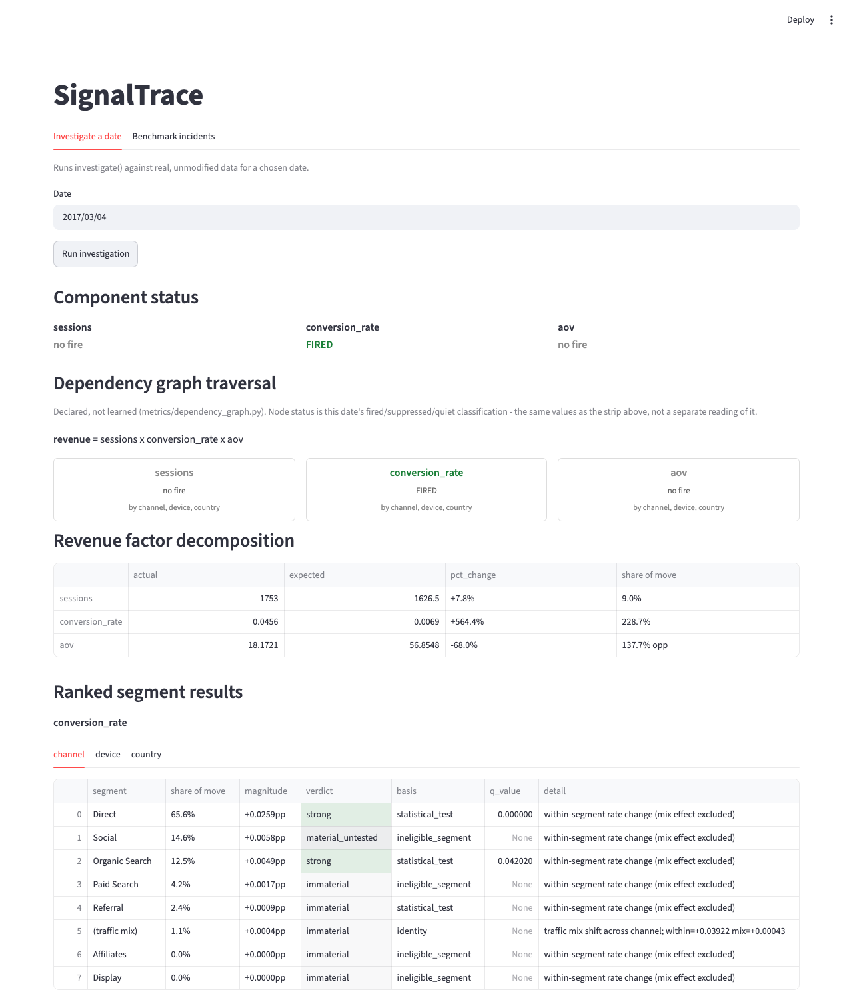

# SignalTrace

SignalTrace explains why a business metric moved. A statistics engine tests every part of the business and records what it finds. A small LLM agent running locally reads that evidence and names the cause, and it can only cite results the engine produced.

I tested it on a year of Google Merchandise Store analytics data with problems I planted on known dates, then compared the agent with the engine on 73 dates I had locked away before building the agent.

## The result

| on 73 locked dates | agent | engine |
|---|---|---|
| Named the planted cause as its #1 answer (46 dates with a planted cause) | 17 | 7 |
| Normal days where it reported a problem with confidence (9 normal days) | 4 | 1 |
| Said "nothing is wrong" on a normal day (9 normal days) | 0 | 0 |
| Identified a spread-out or traffic-mix cause (18 dates) | 0 | not possible: its selection rule never outputs a spread-out or mix pattern |

On the dates where only one of them got the #1 cause right, the agent was right on 12 and the engine on 2 (exact two-sided sign test, p = 0.013). On Score A (right segment, right direction) they gave the same pass or fail on 54 of 55 date-targets, which makes sense because they read the same evidence. The agent ran 3 times per date and gave identical answers every time, so each date counts once.

The engine does not name a single top cause on its own, so its #1 answer comes from a simple rule I fixed before the test (PLAN 5.5). My claim is narrower than "the agent is a better diagnostician": given the same evidence, the agent is better at picking which cause matters most. It is also worse on normal days, where it reports problems that are not there.

Built with: Python 3.13, DuckDB, pandas, NumPy, SciPy, Streamlit, Ollama (with its Python client), and the model qwen3:8b.

Full tables, the integrity check and the dev comparison are in `evaluation/results/agent_heldout_f854dee9_report.md` and `notes/PLAN.md` section 7.1.



The dashboard's "Investigate a date" tab for 2017-03-04, after clicking Run investigation.

## What it does

**The engine** is deterministic and has no LLM in it.
- It models Revenue = Sessions x Conversion Rate x AOV, and the identity holds exactly by construction.
- It detects anomalies at the component level, then tests every segment of every dimension (channel, device, country).
- Count-based tests use a per-segment dispersion correction with a negative-binomial form, because session counts are far more overdispersed than a Poisson model assumes.
- The validator is contribution-first: a segment must carry a material share of the move before its significance matters.
- Every result goes into an append-only evidence ledger, including the negative ones.

**The agent** is qwen3:8b served by Ollama, so it runs locally and costs nothing per call.
- Its tools return engine output only: a factor decomposition, a per-dimension test, and a ledger summary.
- It cites rather than transcribes. Each claim names an evidence id, and the harness fills in the metric, segment, direction and verdict from the ledger.
- A checker rejects any claim it cannot match to a ledger entry, and any claim whose direction or strength does not match that entry.

## How it was evaluated

- **Data:** the GA360 sample (Google Merchandise Store), 12 months, aggregated to date x channel x device x country.
- **Incidents:** nine incident types with known answers. Eight are injected into real data (I1, I2, I3, I3b, I4, I5, I6, I7) and one is a null control (C1).
- **Dev and held-out:** 41 dev dates were used for all tuning. 73 held-out dates (9 per incident, 1 for I3b) came from a seeded draw (seed 20261001) and were frozen before any agent code existed (tag `heldout-frozen`, SHA-256 recorded in PLAN 5.4).
- **Freezes:** the engine was frozen (tag `engine-frozen-m5`) and the agent was frozen (tag `agent-frozen`) before the single held-out run.
- **Selection rule:** at most 5 prompt versions, and the rule for choosing among them was written down before the first real run. Every version's dev results are kept, including the failures.

| candidate (dev) | top-1 (of 26 named-cause dates) |
|---|---|
| prompt v0 | 12 |
| prompt v1 (selected) | 16 |
| prompt v2 | 1 |
| prompt v3 | 13 |
| prompt v4 | 15 |
| v1 with think mode | 10 |
| engine | 15 |

Prompt v2 collapsed to a top-1 of 1. Think mode lowered top-1 from 16 to 10. On dev the two arms were close (16 vs 15). On held-out the gap widened (17 vs 7 dates). Dev dates were screened and re-swapped during benchmark construction and held-out dates were not, so both arms score lower on held-out.

## What went wrong, and how it was handled

- **Two invalidated held-out attempts.** The first loaded dev dates instead of held-out dates. The second hit the injector's dev-date guard. I caught both before any model call on a held-out date, kept the files without analyzing them, and fixed the runner (PLAN 4.10.1, 4.10.2).
- **Truncated context.** An early run lost the `submit_answer` schema because Ollama loaded the model with an 8192 context. I fixed it with compact tool output, a context guard that fails loudly, and a token cap (PLAN 4.1 amendment).
- **Shared-config failures.** Nine runs in one dev evaluation failed with HTTP 400 "model is required". I did not confirm the cause. I made the request config immutable, added request logging and a circuit breaker, invalidated that run and redid it, and the failure did not recur.
- **The `--version` default.** The runner defaults to v4 and the frozen agent is v1. The held-out guard correctly refused the default, so the run used `--version v1`. I have not changed the default.
- **"No ledger entry" label.** The checker uses this reason for rows that exist and were shown to the model but are marked not claimable. I checked all 300 held-out claims with this label by replaying the tool layer, and none were harness mismatches. I left the misleading label as it is because the agent code is frozen.
- **A corrected finding.** PLAN 4.9 said thinking "cited nonexistent evidence ids". The replay showed all 8 were non-claimable rows. I corrected the finding in place and kept the original text.
- **One interrupted run.** The held-out run stopped after 194 runs, and I resumed it with the same command for the last 25. Both sessions ran the frozen configuration.

The integrity scripts are in `evaluation/integrity/`. `replay.py` prints `INTEGRITY: PASS` when no claim is a harness mismatch, and `analyze.py` reproduces the comparison tables and the sign test.

## Limitations

- Only 12 months of data, so there is no seasonality model.
- AOV segments cannot be significance-tested with daily aggregates.
- Device and country are each dominated by one segment.
- The agent never identifies broad, mix or none. It outputs `localized` on every run.
- The agent over-claims on normal days.
- One small local model was used.
- The benchmark incidents are self-designed. I wrote the ground truth myself, so it is not independent.

## Run it locally

Python 3.13 is the version used here.

1. Create the environment.
   ```
   python -m venv .venv
   .venv/bin/pip install -r requirements.txt
   ```
2. Get the data. Run `sql/ga360_export.sql` in BigQuery and save its two result sets as `data/raw/ga_sessions_daily.csv` and `data/raw/order_concentration.csv`. I reconstructed that query from the loader's expected schema, because the original export query was not saved.
3. Build the DuckDB file with both loaders (each drops and recreates its tables).
   ```
   .venv/bin/python ingest/load_ga.py
   .venv/bin/python ingest/load_order_concentration.py
   ```
4. Run the dashboard.
   ```
   .venv/bin/streamlit run app/dashboard.py
   ```
   It serves on http://localhost:8501.
5. Run the engine benchmark on the dev dates.
   ```
   .venv/bin/python -m evaluation.score
   .venv/bin/python -m evaluation.arm_neutral
   ```
6. Install Ollama, pull the model, and run the agent on dev. The pinned model is `qwen3:8b` (digest in `agent/config.py`). Use `--version v1` for the frozen agent, and add `--limit 2` for a short trial.
   ```
   ollama pull qwen3:8b
   .venv/bin/python -m evaluation.run_agent --split dev --version v1 --limit 2
   ```
7. Run the tests and the integrity check.
   ```
   .venv/bin/python -m pytest tests
   .venv/bin/python -I evaluation/integrity/replay.py evaluation/results/agent_heldout_f854dee9.jsonl --split-at 194
   ```

The held-out split of `run_agent` needs the `agent-frozen` tag, `--version v1` and `--i-confirm-heldout`. It was run once and should not be run again.

## Repo map

| path | contents |
|---|---|
| `ingest/` | GA360 load into DuckDB, and the baseline characterization |
| `metrics/` | the metric dependency graph and segment eligibility |
| `detection/` | expectation model, component anomaly detection, all measured settings |
| `investigation/` | hypotheses, attribution, dispersion, validator, evidence ledger, orchestrator |
| `agent/` | frozen agent: model pin, tools, prompt versions, rendering, loop and checker |
| `evaluation/` | incident injector, ground truth, held-out selection, scorers, runners |
| `evaluation/results/` | every dev and held-out result file and report |
| `evaluation/integrity/` | the replay and analysis scripts behind the integrity check |
| `app/` | Streamlit dashboard |
| `sql/` | reconstructed BigQuery export query for the two input CSVs |
| `tests/` | tests for the agent tools, loop and runner |
| `notes/` | `PLAN.md` (design, decisions, protocol, results), `baseline.md`, `RESUME.md` |

Start with `notes/PLAN.md` for the decisions and `evaluation/results/agent_heldout_f854dee9_report.md` for the held-out numbers.

Tejas Naik · https://www.linkedin.com/in/tejas-naik-22933019b
